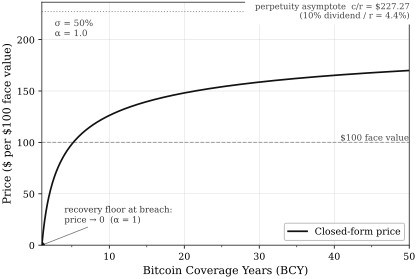
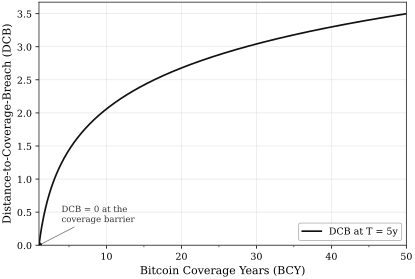
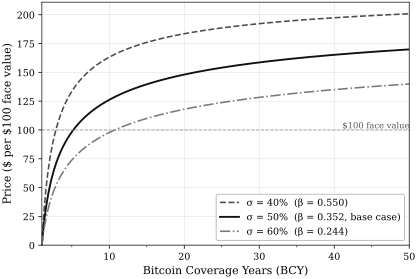
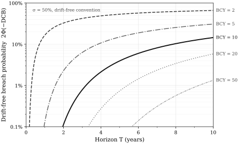

# Perpetual Preferred Equity Against Bitcoin: A Closed-Form Structural Credit Model

Jackson Fairbanks
Risk Analyst, Strive
August 2026

## Abstract

This paper develops a closed-form structural credit model for perpetual preferred equity issued against a Bitcoin reserve. The instrument is perpetual equity. It has no maturity and is not debt. Its only payment is the preferred dividend. No redemption of the notional is scheduled, and no coverage level requires it. Solvency therefore turns on coverage of the dividend payments, not redemption of the notional. The model inherits the Black and Cox (1976) perpetual-claim closed form. Two reinterpretations adapt it to the instrument. First, both structural inputs are read off the market: the reserve value observed directly, and its volatility estimable from market data. Second, breach occurs at first passage of the reserve to an exogenous coverage barrier rather than an endogenous default boundary. The model produces two outputs. The first is a closed-form price equation for the instrument across the coverage domain: the present value of the dividend payments until the reserve first reaches the barrier. Recovery is zero because the contract provides for none. The second is the Distance-to-Coverage-Breach (DCB): the vol-scaled log-distance of the current reserve from the barrier, a single scalar invariant to the discount rate and the recovery assumption. The model extends to a multi-tranche preferred stack, where seniority is priced through ordered survival rather than recovery. The coverage barrier modeled in this paper sits by convention at one year of forward coverage, well above the level at which the reserve is exhausted. Neither output estimates where distress begins. They serve as a structural reference for market pricing, coverage monitoring, and future calibration.

## 1. Introduction

Perpetual preferred equity issued against a Bitcoin reserve produces a distinctive credit problem. The instrument has no maturity or scheduled redemption of the notional, so solvency does not resolve at a single date.[^fn-solvency] It is a running condition, met as long as the reserve covers the dividend payments and breached when it no longer does. Merton (1974) created the structural credit model from option-pricing theory (Black and Scholes, 1973), valuing a firm's obligations as contingent claims on its assets. Black and Cox (1976) added the exogenous first-passage barrier, letting default occur the moment asset value crosses it rather than only at maturity. They also solved the perpetual case (§IV), the form this paper inherits. A perpetual stream of payments is time-homogeneous: the time dimension drops out of the pricing problem, reducing it from a partial differential equation to an ordinary one with a closed-form solution. The machinery to price a perpetual stream of payments against a first-passage default boundary is therefore established and decades old.

[^fn-solvency]: Solvency carries its going-concern sense throughout. The modeled issuer carries no debt, so the legal tests of insolvency do not apply, and a dividend is not a debt until declared.

This paper adapts that machinery to the instrument. It takes the perpetual-claim ODE, its closed-form solution, and the exogenous first-passage barrier. Two reinterpretations, set out in §3.4, adapt the inherited machinery to the specific features of perpetual preferred equity against a Bitcoin reserve.

The paper contributes a closed-form perpetual structural credit model with a coverage-defined exogenous barrier on a directly observable reserve, for an instrument with no scheduled redemption and no coverage level that requires one. The closest prior work, Barone (2021), differs in instrument, barrier logic, asset, and contribution type (§6.1). The framework produces two outputs, both written in Bitcoin Coverage Years (BCY), the sufficient statistic for breach risk within the model. The first is a closed-form price equation across the coverage domain. The second is the Distance-to-Coverage-Breach (DCB), a single scalar whose distinctive property is decoupling. DCB is constructed to be invariant to the discount rate r and the recovery assumption α. In form, DCB is a vol-scaled log-distance to the barrier, a parallel to KMV's distance-to-default. By convention the coverage barrier modeled in this paper sits where the reserve covers one forward year of dividend payments, but can be placed at any coverage level. An issuer with the full optionality of its capital stack has the incentive to act above it. The model counts only the reserve and sets recovery at breach to zero. The issuer's capital-markets access, cash reserves, other assets, and further optionality are reserved for future calibration. The contribution is structural, not empirical. Calibration of the model against forward-simulation distributions, rating-agency-anchored bridges, and accumulated breach experience over time is identified as future work.

The model's two structural inputs are market quantities, not model-implied. The Merton-KMV tradition (Merton, 1974) backs out asset value and asset volatility through the model itself. Here the reserve comes from issuer treasury disclosure and the spot price, and its volatility is estimable from market data. The model therefore does not carry the estimation error of inferring its own inputs.

§2 establishes the instrument: the asset, the dividend payments, Bitcoin Coverage Years (BCY), the coverage barrier, and the pure-play scope under which the framework is developed. §3 develops the structural model, producing the closed-form price equation and DCB. §4 reports sensitivities to recovery, volatility, the discount rate, the DCB reporting horizon, and the barrier level, and summarizes the comparative statics. §5 extends the model to a multi-tranche preferred stack through cumulative dividend barriers, pricing seniority as ordered survival. §6 restates the contribution, establishes framework generality, states limitations, and identifies future work.

## 2. The Instrument and the Coverage Framing

### 2.1 The instrument

The instrument is perpetual preferred equity issued against a Bitcoin reserve. The dividend payments run perpetually against the reserve. The instrument is equity, not debt. No redemption of the notional is scheduled, and no coverage level requires it.[^fn-certificate-terms] The notional is retired only at the issuer's initiative. It ranks as a liquidation preference senior to common equity, realizable only in a wind-up. For an instrument whose notional is due on a date, coverage of the notional is a natural measure of solvency. Here there is no such date. The reserve must cover the dividend payments, not the notional. Solvency therefore does not resolve at a single date. It is a running condition, and it turns entirely on the dividend payments. Structurally, the instrument is worth the present value of its dividend payments until they stop. §3 develops the structural credit model that prices it.

[^fn-certificate-terms]: Terms set by the issuer at issuance may qualify this. A fundamental-change put, for instance, gives the holder the right to compel repurchase at the stated amount plus accrued dividends upon a fundamental change. Such terms are at the issuer's discretion, and any right to compel they create is exercisable only in consequence of the issuer's own actions. No coverage level triggers such a right, and it lies outside the model.

### 2.2 The asset

The asset side of the framework is the Bitcoin reserve. Its value is the Bitcoin held times the spot price, V_t = N_BTC,t · P_BTC,t. Both are observable in real time, the holdings from issuer treasury disclosure and the price from continuously traded spot markets, so V_t is directly observable without any structural-model machinery.

This distinguishes the present setup from Merton (1974) and the Moody's KMV implementation that descends from it. In those frameworks, the firm-level asset value V_A is not directly observable. It must be implied from equity prices via the structural model itself, with the asset volatility solved jointly. Here, V_t is a market quantity, and σ is the volatility of that same quantity, estimable directly from market data. This simplification is taken up explicitly in §3.4 as the first reinterpretation.

The model assumes that the reserve is not drawn down to meet the dividend. In this respect the present setup follows Merton, the option-pricing tradition before it (Black and Scholes, 1973), and the Merton-KMV tradition after it, none of which models the source or effect of payments, only whether asset value covers them. The funding of the dividend payments lies outside the model. §6.3 carries it as the capital-access component of the model-vs-market gap. The reserve is further assumed exogenous to the issuer's own transactions. The issuer is a price-taker in the reserve market, not a participant whose trades move its price. Holdings are taken as disclosed. Custody, encumbrance, and verification risk lie outside the model.

### 2.3 The dividend payments

The reserve is measured against the preferred's future dividend payments. Let C denote the annual dividend payments in dollars: for an issue with notional N and dividend rate c, C = c · N. C is treated throughout as a continuous flow, the standard convention in the structural credit literature (Black and Cox, 1976). Payment timing therefore does not enter the model: paid daily, monthly, or quarterly, the reserve is measured against the same annualized dividend payments C. Bitcoin Coverage Years (§2.4) is a scale-free ratio, so the model expressed in it is invariant to issue size and denomination. The rate c is held fixed throughout. A variable rate, where one applies, is a calibration-layer concern, not part of the foundational model.

### 2.4 Bitcoin Coverage Years

Bitcoin Coverage Years (BCY) is the ratio of Bitcoin reserve value to annual dividend payments:

```math
\mathrm{BCY}_t = V_t / C.
```

The unit is years of forward coverage: BCY_t = 3 means the reserve equals three years of dividend payments.

BCY is the sufficient statistic for breach risk within the model. Because the instrument is perpetual, no maturity date introduces a separate time dimension, and the only state that governs forward solvency is the current level of coverage. The closed form in §3 is therefore written in BCY alone.

The ratio also collapses the capital structure into a single number. BCY depends only on reserve value and the annual dividend payments in dollars, not on how they split into notional and dividend rate. Two issuers at the same BCY face the same forward-solvency problem, and the model prices that coverage identically across them. Any difference in their notional matters for recovery in a wind-up, not for forward solvency, and so lies outside the model (§2.1).

BCY is developed empirically in Fairbanks (2026, §3).

### 2.5 The coverage barrier

The model reads solvency off the reserve (§2.2) in BCY, years of forward coverage of the annual dividend payments (§2.4). The coverage barrier is the floor of that reading: BCY = 1, the threshold level at which the reserve no longer covers one forward year of dividend payments. Reaching the barrier is the coverage breach. The barrier tests the reserve against the dividend payments, not against the notional (§2.1).

Every candidate level above the coverage barrier is behavioral. It turns on the responses a real issuer might deploy under stress, such as cash reserves, capital raises, or dividend actions, an open and instrument-specific set that the model fixes nowhere and identifies as future work (§6.3). The only level below the barrier that the structure itself supplies is terminal reserve exhaustion. BCY = 1 is the level the coverage unit itself fixes: one forward year. It adds no assumption beyond the unit, and it recognizes breach a full forward year of coverage above exhaustion. The level is a modeling convention: the barrier can be placed at any coverage level (§4.5, Proposition 3). An exogenous barrier is also what the first-passage machinery prices against: an observable level fixed outside the model.

The closest institutional precedent for coverage-driven valuation of perpetual preferred anchors coverage differently. The closed-end-fund preferred rating framework under the Investment Company Act of 1940 §18 anchors coverage to the liquidation preference. That framework treats the liquidation preference as a contingent payment obligation, because the fund's terms require redemption at that amount when asset coverage falls below a defined level. By contrast, no coverage level requires redemption of this instrument. Coverage here is of the dividend payments, not the notional. The annual dividend payments are the notional times the rate, so BCY captures both: two issuers with identical notional coverage but different dividend rates have materially different forward coverage.

The notional amount stays out of the price on two independent grounds. The first ground is arithmetic. At the coverage barrier the reserve equals the dividend rate applied to the notional: one forward year of dividend payments. So even under a reading that treats breach as a liquidation, recovery would be bounded by the reserve, which is a fraction of the notional. §4.1 reports the price across this recovery range. The second ground is contractual. No redemption of the notional is scheduled, and the liquidation preference is realizable only in a wind-up, which lies outside the model. On either ground the notional does not enter the price. §3.4 takes up the recovery treatment.

### 2.6 Pure-play scope

This paper models perpetual preferred equity issued against a Bitcoin reserve, with the preferred dividend as the issuer's only payment and Bitcoin its only reserve asset. Debt and dated preferred fall outside its scope. The perpetual case is not an approximation but the instrument's contractual form. Adding a second asset or cash-flow process is future work (§6.3). Multiple preferred tranches fall within scope: §5 prices a stack of n tranches through cumulative dividend barriers, and n = 1 recovers the single-tranche model.

## 3. The Structural Model

This section develops the structural credit model. §3.1 sets out the asset process and the assumptions. §3.2 states the inherited Black and Cox (1976) perpetual-claim closed form under this setup's boundary conditions. §3.3 defines the discount exponent β and the breach factor that enters the price, and records the undiscounted finite-horizon probability that underpins DCB, both derived in Appendix A. §3.4 states the two reinterpretations that adapt the inherited machinery to the instrument: the model's inputs are market quantities rather than model-implied, and the barrier is exogenous, placed at one year of forward coverage, with recovery at breach unenforceable and taken as zero. §3.5 presents the closed-form price equation. §3.6 presents Distance-to-Coverage-Breach.

### 3.1 Setup

The Bitcoin reserve V_t evolves as a geometric Brownian motion. Under the physical measure,

```math
dV_t = \mu V_t\, dt + \sigma V_t\, dW_t, \qquad \text{(3.1)}
```

and under the risk-neutral measure used for valuation,

```math
dV_t = r V_t\, dt + \sigma V_t\, dW_t^Q. \qquad \text{(3.2)}
```

Here r is the continuously compounded risk-free rate, σ is the annualized asset volatility, and μ is the physical-measure drift. The coverage barrier from §2.5 is

```math
V_B \;=\; C \cdot 1\text{ year}, \qquad \text{equivalently the barrier sits at } \mathrm{BCY}_t = 1, \qquad \text{(3.3)}
```

so V_B is the reserve level at which BCY = 1. Recovery on coverage breach is

```math
R \;=\; (1-\alpha)\, V_B, \qquad \alpha \in [0,1], \qquad \text{(3.4)}
```

with α the recovery-loss fraction. The base case throughout this paper is α = 1.0, giving R = 0: at breach the holder has no claim to enforce (§3.4).

The five technical assumptions of the model are stated explicitly:

Assumption 1. Risk-neutral measure for pricing. Physical measure (drift-free) for DCB. Pricing is conducted under the risk-neutral measure where the asset's drift equals r. DCB uses the physical-measure first-passage form with drift suppressed for institutional defensibility. The price is a risk-neutral quantity and depends on r. DCB is a physical-measure distance and does not.

Assumption 2. No continuous yield or payout from the BTC reserve (δ = 0). This preserves the exponent β = 2r/σ² exactly. Any continuous reserve yield would shift β and require re-derivation of the closed form.

Assumption 3. The reserve is not drawn down by the dividend payments. It evolves as the asset process in (3.1)–(3.2), and the coverage barrier is reached as a first-passage event of V to V_B, not as gradual erosion of V by dividend outflows. How the dividend is funded period to period is not modeled, consistent with the structural treatment of the asset in §2.2. Black and Cox (1976, §IV) make the same assumption, with coupons financed by new issuance rather than asset sales. Funding the dividend from the reserve would add a downward drain to the asset process, lowering the price and raising the breach probability.

Assumption 4. Recovery is proportional to V_B at breach: R = (1 − α)·V_B. Black and Cox (1976, eq. 16) recover the full barrier value V_B. The (1 − α) factor generalizes this to partial recovery. The base case α = 1.0 sets recovery to zero, as developed in §3.4. Sensitivity across α ∈ [0, 1] is reported in §4.

Assumption 5. σ is constant in time and across BCY regimes. The closed form requires constant σ. Extensions to richer processes (GARCH-family, jump-diffusion, regime-switching) or to resampling methods (block bootstrap) do not preserve the closed form derived here and are identified as future work in §6.

### 3.2 Inherited machinery

Black-Scholes and Merton built a no-arbitrage method for pricing a contingent claim on a diffusing underlying (Black and Scholes, 1973; Merton, 1973). Merton (1974) applied this to corporate credit: the firm's debt is a contingent claim on firm value, with default resolved at maturity. Black and Cox (1976) allowed default to occur at any time rather than only at maturity, as first passage of firm value to an exogenous barrier. They also solved the perpetual case (§IV), the form this paper inherits. A perpetual stream of payments against a diffusing asset is time-homogeneous, governed by an ODE with a closed-form solution (their eqs. 13, 14, 16), and one whose failure condition is a coverage barrier crossable at any time is precisely the object this machinery prices. A finite-horizon treatment of the same instrument must evaluate breach at a fixed date, which a perpetual does not contractually have. The date must then be assumed rather than read from the instrument, and it enters the breach probability directly. The perpetual form removes that input: the breach factor (3.6) carries the entire infinite horizon, so no date is selected and none is assumed.

Under the two boundary conditions, recovery at the coverage barrier (F(V_B) = R) and the perpetuity asymptote (F(V) → C/r), the Black and Cox (1976) perpetual-claim ODE (their eq. 13) has the closed-form solution (3.7), derived in Appendix B.

### 3.3 The breach factor

The breach factor integrates the entire future of breach risk into a single scalar. Applied as a haircut to the present value of the risk-free stream of dividend payments, it turns that risk-free value into the price. Formally, it is the Laplace transform of the first-passage time to the coverage barrier. It applies the discount exponent β to the coverage level BCY. The discount exponent β collapses the reserve's diffusion, every path by which it could reach the barrier, into one exponent. The coverage level BCY is the distance the reserve sits from the barrier.

The discount exponent is

```math
\beta \;=\; 2r/\sigma^2. \qquad \text{(3.5)}
```

The physical-measure drift μ does not enter β: pricing is conducted under the risk-neutral measure, where the reserve's drift is the discount rate r, with no continuous reserve yield (Assumptions 1 and 2). β is discounting speed over diffusion speed, 2r over σ². A higher discount rate raises it: the reserve drifts up faster and a dollar paid at breach is discounted harder, so breach is priced as more remote. Higher volatility lowers it: the reserve can reach the barrier sooner, so breach is priced as nearer.

The breach factor applies β, the reserve's path to the barrier, to BCY, the distance the reserve sits from the barrier, (V_B/V_0)^β = BCY^(−β). The result is a single number from the breach-time distribution: the present value, at the discount rate, of one dollar paid at the random first time V_t touches V_B. Under the risk-neutral GBM it has the closed form

```math
\bigl(V_B/V_0\bigr)^{\beta} \;=\; E^Q\!\left[e^{-r\tau}\,\mathbf{1}_{\{\tau<\infty\}}\right] \qquad \text{(3.6)}
```

(derivation in Appendix A). At the base case β = 0.352, and doubling coverage lowers the factor by about a fifth. With zero recovery, the price in §3.5 is the risk-free perpetuity C/r times one minus the factor just described, (C/r)[1 − (V_B/V_0)^β].

The finite-horizon breach probability under (3.1), the probability of breach by a fixed date T, has a standard closed form (Appendix A). DCB in §3.6 is the drift-free reduction of its argument.

### 3.4 The two reinterpretations

The Black and Cox (1976) perpetual-claim closed form is the base equation. Two reinterpretations adapt it to the instrument.

The first reinterpretation is of the asset. In Black and Cox, V is firm asset value. It is unobservable, and in the Merton-KMV tradition it is backed out from equity through the structural model itself. Here, the reserve V_t is observable directly in real time from issuer treasury disclosure and the spot price (§2.2). Its volatility σ is estimable directly from market data. The model is therefore simpler than Merton-KMV in this dimension.

The second reinterpretation is of the barrier and the recovery treatment on breach of it. Because the instrument is perpetual preferred equity with no default event and no scheduled redemption (§2.1), there is no optimal-default boundary for the issuer to solve. The Black-Cox exogenous first-passage barrier is therefore placed at the coverage barrier V_B = C · 1 year (BCY = 1), rather than derived endogenously or anchored to the notional (§2.5). The coverage barrier is a structural floor: it sits at one forward year of coverage, well above terminal reserve exhaustion. The one-year level is a modeling convention: the barrier can be placed at any coverage level.

Recovery in the Black-Cox base is the full barrier value V_B (eq. 16). The paper generalizes to (1 − α)V_B and sets α = 1 (R = 0). The instrument as scoped has no event at the barrier that produces the recovery the inherited equation assumes. The holder's liquidation preference ranks ahead of common equity, and is realizable only in a wind-up the holder cannot force. That senior claim reaches the price only as recovery, which the base case sets to zero. The α parameter is retained for sensitivity only (α ∈ [0, 1], reported in §4). The structural ceiling on any positive recovery is V_B by construction, the reserve value on breach of the coverage barrier. In this respect the present model differs from debt-based structural credit (Black and Cox, 1976; Merton, 1974; Barone, 2021; the Moody's KMV implementation). All of these carry a formal bankruptcy mechanism with positive recovery as the canonical case.

The first-passage construction makes the coverage barrier absorbing. In the model, a reserve that reaches the barrier ends the dividend payments. In reality there is no such event, so a reserve that reaches the barrier could recover, leaving the instrument intact. Two quantities are therefore zero at breach for different reasons. Recovery is zero because the contract provides no claim a holder can enforce outside of a wind-up. Continuation value after a recross is zero by construction, a modeling choice rather than a contractual fact. Its exclusion lowers the model price, and §6.3 carries it in the model-vs-market gap.

### 3.5 The closed-form price equation

The closed-form price of the perpetual preferred at reserve level V_0 is

```math
P_0 \;=\; \frac{c}{r}\!\left[1 - (V_B/V_0)^{\beta}\right] \,+\, R\, (V_B/V_0)^{\beta}, \qquad R = (1-\alpha)\,V_B. \qquad \text{(3.7)}
```

At the α = 1.0 base case, R = 0 and the equation collapses to a single term:

```math
P_0 \;=\; \frac{c}{r}\!\left[1 - (V_B/V_0)^{\beta}\right]. \qquad \text{(3.8)}
```

Quantities are stated per $100 of face value. Here c is in dollars rather than a rate, so a 10% dividend gives c = 10 and C = c (§2.3). Equivalently, (3.7) can be written in BCY_0 directly via V_B/V_0 = 1/BCY_0.

The price equation has two components, a perpetuity term and a recovery term. In the base case the recovery term drops out, because recovery is zero. The perpetuity term (c/r)·[1 − (V_B/V_0)^β] is the present value of the dividend payments received prior to breach: the risk-free perpetuity c/r weighted by one minus the breach factor of (3.6). The recovery term R·(V_B/V_0)^β is the present value of recovery received at breach: the recovery amount weighted by that same factor. The breach factor (V_B/V_0)^β from (3.6) is the bridge between the perpetual stream of dividend payments and the distance the reserve sits from the coverage barrier.

The price rises with coverage and is concave throughout, with the (V_B/V_0)^β factor producing a smooth transition from the risk-free perpetuity asymptote at high BCY down to recovery R at the coverage barrier. At base-case parameters (r = 4.4%, σ = 50%, a 10% dividend rate giving c = 10 per $100 face, α = 1.0), β = 2r/σ² = 0.352. At high coverage the curve enters its asymptotic approach to c/r = $227.27, with each additional year of coverage adding diminishing dollar value. The full curve appears in Figure 1 and as the α = 1.0 column of Table 1.



**Figure 1.** Closed-form price of the instrument as a function of Bitcoin Coverage Years (BCY), at base-case parameters: a 10% dividend (c = $10 per $100 face value), r = 4.4%, σ = 50%, α = 1.0. The curve is the model's price under the modeled asset process, a structural reference for market pricing, not a forecast of market price. As coverage rises the price approaches the perpetuity value c/r = $227.27 (the 10% dividend over the 4.4% discount rate); at the coverage barrier, BCY = 1, it returns the recovery floor, which is zero at α = 1.0. The $100 line marks face value for scale and is not a predicted trading level.

Four boundary cases anchor intuition. As V_0 → ∞ (deep coverage), (V_B/V_0)^β → 0 and the price approaches the risk-free perpetuity asymptote c/r. The perpetuity-term coefficient approaches one and the recovery-term contribution vanishes. At V_0 = V_B (coverage barrier, BCY = 1), (V_B/V_0)^β = 1 and the closed form returns P = R independent of σ and r. The coverage barrier is therefore a degenerate point: the model adds informational content above it, but at the barrier it returns only what was assumed about recovery. As σ → 0, β → ∞ and (V_B/V_0)^β → 0 for any V_0 > V_B, so the price approaches c/r, the deterministic case in which breach above the starting BCY is impossible. As σ → ∞, β → 0 and (V_B/V_0)^β → 1 for any V_0. The price collapses to R at every BCY, and coverage breach is almost sure in this limit.

For comparability with corporate credit, the running yield is c/P_0 and the yield spread is that minus r.

### 3.6 Distance-to-Coverage-Breach

The price equation in §3.5 is the model's first output. The model's second output is a single scalar: the Distance-to-Coverage-Breach (DCB), defined as

```math
\mathrm{DCB} \;=\; \frac{\ln(\mathrm{BCY}_0)}{\sigma\,\sqrt{T}}. \qquad \text{(3.9)}
```

By construction, DCB is invariant to the discount rate and the recovery assumption: both enter the price, neither enters the distance. DCB requires no position on either in order to monitor coverage, compare instruments, or report across entities and horizons.



**Figure 2.** Distance-to-Coverage-Breach (DCB) as a function of BCY at the base reporting horizon T = 5 years and σ = 50%. DCB is a vol-scaled log-distance from current coverage to the coverage barrier: a structural breach distance, not a default-probability estimate. DCB is zero at the coverage barrier (BCY = 1) and rises with coverage. By construction it does not depend on the discount rate r or the recovery parameter α.

The invariance is structural, not an artifact of measuring distance in coverage units. The discount rate is a pricing parameter, and the distance DCB measures is a property of the reserve's path, which discounting does not enter. So r enters the price and not the distance, as §4.3 and §4.7 show. α sits outside the distance for the same reason: it fixes only what is recovered after a breach, not the path to it. A dependence on either the discount rate or recovery would conflate distance with valuation.

Distance-to-Coverage-Breach parallels KMV's distance-to-default: a vol-scaled log-distance from the current reserve to a barrier over a reporting horizon T. The parallel locates DCB within the credit-modeling tradition of distance-to-threshold metrics. Two differences from KMV's DD must be flagged. First, KMV's DD pairs with an empirical pipeline that maps DD to expected-default frequencies (EDFs) via a calibration database accumulated over decades of corporate default experience. DCB has no analogous pipeline because the instrument class has no comparable history. DCB is a structural distance metric, not a default-probability metric, and the paper does not make claims of the latter form. Second, DCB's inputs are pre-model quantities: BCY_0, observable from issuer treasury disclosure and continuously traded BTC spot markets; σ, estimable from market data; and T, chosen by the user. KMV's DD requires two further ingredients before its inputs exist: an iterative procedure to extract asset value V_A and asset volatility from observable equity, and the fitted default-point heuristic (DPT = STD + 0.5·LTD; Crosbie and Bohn, 2003) for the threshold. Neither is needed here. Institutionally meaningful horizons for T include 1 year (Basel IRB, IFRS 9), 5 years (credit-committee and CDS-tenor horizons), and 10 years (long-cycle stress).

DCB drops the physical-measure drift μ and the Itô correction term that would appear in the full first-passage argument [ln(BCY_0) + (μ − σ²/2)T]/(σ√T). This is a deliberate simplification. Drift is among the most contested BTC inputs, and a drift-free DCB is more institutionally defensible. The convention is not free. Volatility alone drags the median path down by σ²/2 per year, 12.5% at σ = 50%.[^fn-variance-drag] Dropping the drift term understates the distance when μ exceeds that drag, overstates it below, and the gap grows with horizon. DCB is therefore a vol-scaled log-distance, structurally analogous to KMV's DD with the drift term suppressed. It is not literally Φ⁻¹ applied to a physical-measure breach probability, and the paper does not make that claim.

The price equation in (3.7) and DCB in (3.9) are the two outputs of §3 (Figures 1 and 2), neither derived from the other. They answer different questions. The price equation produces a structural reference price and a running yield: what the dividend payments are worth under the modeled process. DCB produces a single scalar reportable across horizons: how far the reserve stands from breach.

[^fn-variance-drag]: The drag is the compounding cost of symmetric moves. A reserve rising 50% one year and falling 50% the next has an arithmetic average return of zero. It stands at 1.5 × 0.5 = 75% of its starting value. In continuous time the decay rate is exactly σ²/2.

## 4. Sensitivity and Robustness

This section reports the sensitivity of the price and DCB to the model's parameters. Tables report per $100 of face value at a 10% dividend rate (c = 10) as a convention. The model is invariant to issue size and denomination (§2.3). Subsections §4.1–§4.3 cover the price sensitivities to recovery (α), volatility (σ), and the discount rate (r), with the remaining parameters held at base case. Each closes with the DCB response to the parameter. §4.4 covers the DCB response to the reporting horizon T. §4.5 reports the price across the coverage barrier convention. §4.6 anchors the four boundary cases of the closed-form price equation (§3.5) numerically. §4.7 reports the comparative-statics summary table.

The base-case parameters throughout are r = 4.4% (10-year US Treasury anchor), σ = 50%, c = 10, α = 1.0, with V_B = $10 (one forward year of the dividend) and β = 2r/σ² = 0.352. At fixed BCY_0, price entries at any other dividend c′ scale by c′/10. Yields, spreads, DCB, and the breach probabilities are unchanged. The BCY_0 grid is {1, 2, 3, 5, 7, 10, 15, 20, 25, 30, 40, 50}, dense where the price curve bends and sparse where it flattens.

### 4.1 Sensitivity to recovery α

Table 1 reports the price across α ∈ {0, 0.25, 0.5, 0.75, 1.0} at r = 4.4%, σ = 50%. Recovery is R = (1 − α)·V_B = (1 − α)·$10 per $100 face value.

**Table 1.** Price (in $ per $100 face value) across α.

| BCY_0 | α = 0.0 (R = 10) | α = 0.25 (R = 7.5) | α = 0.5 (R = 5) | α = 0.75 (R = 2.5) | α = 1.0 (R = 0) |
|------:|-----------------:|--------------------:|------------------:|--------------------:|----------------:|
|     1 |           10.000 |               7.500 |             5.000 |               2.500 |           0.000 |
|     2 |           57.040 |              55.081 |            53.123 |              51.164 |          49.205 |
|     3 |           79.682 |              77.984 |            76.286 |              74.588 |          72.889 |
|     5 |          103.971 |             102.553 |           101.134 |              99.715 |          98.296 |
|     7 |          117.743 |             116.483 |           115.223 |             113.963 |         112.702 |
|    10 |          130.666 |             129.555 |           128.443 |             127.332 |         126.220 |
|    15 |          143.516 |             142.552 |           141.588 |             140.625 |         139.661 |
|    20 |          151.582 |             150.711 |           149.840 |             148.969 |         148.098 |
|    25 |          157.300 |             156.495 |           155.689 |             154.884 |         154.079 |
|    30 |          161.649 |             160.894 |           160.139 |             159.384 |         158.629 |
|    40 |          167.969 |             167.287 |           166.605 |             165.922 |         165.240 |
|    50 |          172.449 |             171.818 |           171.187 |             170.557 |         169.926 |

The BCY = 1 row is the recovery floor at each α: the price equation collapses to P = R = (1 − α)·V_B at the coverage barrier, independent of σ and r (§3.5). The structural ceiling on recovery is V_B = $10 per $100 face value by construction (§3.4): the coverage barrier is the point at which the reserve equals one year of coverage, and there is at most one year of dividend payments to recover from.[^fn-recovery-ruin] The α = 0 column is the maximum-recovery scenario (R = V_B = $10 by construction). The α = 1.0 column is the zero-recovery base case. Recovery here is capped at one year of the dividend, not the notional, by the same equity character that sets the barrier at dividend coverage. It therefore moves price far less than in a debt model.

β does not depend on α, so the curve's shape is unchanged across the sweep. α moves only the level, through the recovery term R·(V_B/V_0)^β alone. At BCY = 1 the spread between the α = 0 and α = 1.0 columns is the full $10 recovery range. At BCY = 50 it is $2.52, 1.5% of price. The deeper the coverage, the less the recovery assumption shifts the price. At the barrier the recovery assumption is the price.

DCB does not vary with α (§3.6): the α-sensitivity sweep applies only to price.

[^fn-recovery-ruin]: The recovery term takes a similar form to the expected discounted penalty function of actuarial ruin theory (Gerber and Shiu, 1998). There, the cost incurred at ruin is a function of the surplus and deficit at the stopping time, never of an external face amount. Keying recovery to the reserve at breach, rather than to the notional, follows the same structure. The processes differ: classical ruin theory uses a jump surplus under the physical measure, while the present model uses a risk-neutral diffusion. The parallel is structural, not an identity of models: it corroborates the state-at-stopping form of recovery.

### 4.2 Sensitivity to volatility σ

Table 2 reports the price across σ ∈ {40%, 50%, 60%} at α = 1.0, r = 4.4%. The corresponding β values are 0.550, 0.352, and 0.244. β is reported to three decimals. All computations use exact β = 2r/σ².

**Table 2.** Price (in $ per $100 face value) across σ.

| BCY_0 | σ = 40% (β = 0.550) | σ = 50% (β = 0.352) | σ = 60% (β = 0.244) |
|------:|--------------------:|--------------------:|--------------------:|
|     1 |               0.000 |               0.000 |               0.000 |
|     2 |              72.041 |              49.205 |              35.423 |
|     3 |             103.070 |              72.889 |              53.526 |
|     5 |             133.492 |              98.296 |              73.921 |
|     7 |             149.336 |             112.702 |              86.029 |
|    10 |             163.219 |             126.220 |              97.822 |
|    15 |             176.022 |             139.661 |             110.037 |
|    20 |             183.522 |             148.098 |             117.998 |
|    25 |             188.575 |             154.079 |             123.799 |
|    30 |             192.268 |             158.629 |             128.310 |
|    40 |             197.390 |             165.240 |             135.030 |
|    50 |             200.842 |             169.926 |             139.927 |

The σ sensitivity anchors on the asymptote share at BCY = 50. Under σ = 40%, the price reaches $200.84, or 88.4% of the perpetuity asymptote c/r = $227.27. Under σ = 50% it reaches $169.93, or 74.8%. Under σ = 60% it reaches $139.93, or 61.6%. Even at this depth of coverage the price sits well below the risk-free perpetuity, and the shortfall widens steeply with volatility: across the 40–60% range the BCY = 50 price loses more than a quarter of the asymptote. The σ = 40% and σ = 60% columns bracket the base case symmetrically, and the curve stays coherent and concave across the sweep. The volatility bracket is a convention, not a forecast. Prices and DCB at any other volatility follow from (3.7) and (3.9) directly.

The mechanism runs through β. The curve's shape (concavity, bend location, and rate of approach to the asymptote) is governed entirely by β = 2r/σ². β is small for any plausible (r, σ) pairing, 0.352 at base case. Low β means the breach factor (V_B/V_0)^β decays slowly in V_0/V_B, which keeps the credit haircut alive at high BCY. Higher σ lowers β further and shifts weight from the perpetuity term (which has the high coefficient c/r) to the recovery term (zero at α = 1.0). As σ rises the curve flattens and shifts down at every coverage level, retaining its concave shape (Figure 3).

DCB moves inversely with σ: at fixed BCY_0 and T, DCB scales as 1/σ, with no other channel. The sweep translates mechanically. Moving from σ = 50% to 40% raises DCB by the ratio 50/40, a 25% gain, and moving to 60% lowers it by 50/60, about 17%.



**Figure 3.** Closed-form price across reserve volatility σ in {40%, 50%, 60%} at r = 4.4%, α = 1.0, with β = 2r/σ² recomputed per curve (β = 0.550, 0.352, 0.244). The σ = 50% base case is the solid line. Each curve is the model's price under the modeled asset process, a structural reference rather than a market forecast. Higher volatility lowers β and lowers the price at every coverage level. Even at deep coverage the price sits well below the perpetuity value, and the gap widens with σ, so the credit haircut does not close. The $100 line marks face value for scale. Exact values appear in Table 2.

### 4.3 Sensitivity to discount rate r

Table 3 reports the price across r ∈ {3%, 4.4%, 6%, 8%} at α = 1.0, σ = 50%. The corresponding β values are 0.240, 0.352, 0.480, and 0.640. The c/r asymptotes are $333.33, $227.27, $166.67, and $125.00.

**Table 3.** Price (in $ per $100 face value) across r.

| BCY_0 | r = 3.0% (β = 0.240, c/r = 333.3) | r = 4.4% (β = 0.352, c/r = 227.3) | r = 6.0% (β = 0.480, c/r = 166.7) | r = 8.0% (β = 0.640, c/r = 125.0) |
|------:|----------------------------------:|----------------------------------:|----------------------------------:|----------------------------------:|
|     1 |                             0.000 |                             0.000 |                             0.000 |                             0.000 |
|     2 |                            51.085 |                            49.205 |                            47.170 |                            44.786 |
|     3 |                            77.257 |                            72.889 |                            68.304 |                            63.120 |
|     5 |                           106.803 |                            98.296 |                            89.693 |                            80.376 |
|     7 |                           124.377 |                           112.702 |                           101.173 |                            89.021 |
|    10 |                           141.520 |                           126.220 |                           111.478 |                            96.364 |
|    15 |                           159.306 |                           139.661 |                           121.239 |                           102.909 |
|    20 |                           170.916 |                           148.098 |                           127.098 |                           106.624 |
|    25 |                           179.386 |                           154.079 |                           131.117 |                           109.070 |
|    30 |                           185.977 |                           158.629 |                           134.096 |                           110.824 |
|    40 |                           195.807 |                           165.240 |                           138.297 |                           113.208 |
|    50 |                           202.979 |                           169.926 |                           141.178 |                           114.777 |

The price falls as r rises, at every BCY > 1. At BCY = 1 the row is flat: P = R, and R contains no r because breach is immediate. r enters the price twice, and the two effects oppose. First, as a discount rate, higher r lowers the perpetuity ceiling: ∂(c/r)/∂r = −c/r² < 0. Second, as a risk-neutral drift (§3.1), higher r raises β = 2r/σ², shrinking the breach factor (V_B/V_0)^β and lightening the haircut. The ceiling effect wins at every BCY > 1. Since e^x − 1 > x for x > 0, the loss in c/r exceeds the gain in the coefficient, and ∂P/∂r is negative.

The r response is disproportionate across BCY. At BCY = 50, a 5pp drop in r from 8% to 3% raises the price by 77% (from $114.78 to $202.98). At BCY = 2, the same drop raises the price by only 14% (from $44.79 to $51.08). The mechanism mirrors §4.1: sensitivity follows the breach factor. Near the barrier the factor is close to one, so little perpetuity value is alive for r to act on. At deep coverage the factor is small and r acts on nearly the full c/r.

DCB does not vary with r (§3.6): the r-sensitivity sweep applies only to price.

### 4.4 Sensitivity of DCB to horizon T

T does not enter the perpetual price equation, so the horizon sensitivity applies only to DCB. Table 4 reports DCB across T ∈ {1, 3, 5, 10} years at σ = 50%. By the §3.6 invariance, one table serves every (r, α) pairing in the §4.1 and §4.3 grids.

**Table 4.** DCB across horizon T (years).

| BCY_0 | T = 1y | T = 3y | T = 5y | T = 10y |
|------:|-------:|-------:|-------:|--------:|
|     1 |  0.000 |  0.000 |  0.000 |   0.000 |
|     2 |  1.386 |  0.800 |  0.620 |   0.438 |
|     3 |  2.197 |  1.269 |  0.983 |   0.695 |
|     5 |  3.219 |  1.858 |  1.440 |   1.018 |
|     7 |  3.892 |  2.247 |  1.740 |   1.231 |
|    10 |  4.605 |  2.659 |  2.059 |   1.456 |
|    15 |  5.416 |  3.127 |  2.422 |   1.713 |
|    20 |  5.991 |  3.459 |  2.679 |   1.895 |
|    25 |  6.438 |  3.717 |  2.879 |   2.036 |
|    30 |  6.802 |  3.927 |  3.042 |   2.151 |
|    40 |  7.378 |  4.260 |  3.299 |   2.333 |
|    50 |  7.824 |  4.517 |  3.499 |   2.474 |

The columns follow the §3.6 horizon conventions. DCB scales as 1/√T across columns: at any fixed BCY_0, the entry at horizon T equals the T = 1y entry divided by √T. A five-year view therefore works with less than half the one-year distance at every coverage level. Longer horizons compress the scalar while preserving the ordering across BCY_0. The breach-distance interpretation carries through unchanged. Figure C.1 (Appendix C) plots the drift-free breach probability 2Φ(−DCB) across horizon at five coverage levels.

### 4.5 Sensitivity to the barrier level

The coverage barrier sits at one forward year of the dividend by convention (§2.5, §3.4). Substituting a κ-year convention rescales the barrier to V_B = κ · C and changes nothing else. The closed form prices the substitution exactly: at the zero-recovery base case, the price at convention κ is the base-convention price read at BCY_0/κ. Table 5 reports the mapping at base case. The columns are one curve read at shifted coverage: the κ = 0.5 column at any BCY_0 equals the κ = 1 column at 2 · BCY_0. Halving the convention moves each price up the curve. Doubling it moves each price down, and a structure at BCY_0 = 2 then starts exactly at the barrier, where the price is the recovery floor. The level of the price curve therefore moves with the convention. Cross-tranche structure does not: breach-factor ratios are invariant to κ (Proposition 3, §5). The convention sets the level of the floors, not their structure.

**Table 5.** Price (in $ per $100 face value) across the barrier convention κ, in forward years of the dividend, with coverage stated at the κ = 1 convention (σ = 50%, r = 4.4%, α = 1.0).

| BCY_0 | κ = 0.5 | κ = 1 | κ = 2 |
|------:|--------:|------:|------:|
|     2 |  87.757 |  49.205 |  0.000 |
|     5 | 126.220 |  98.296 | 62.657 |
|    10 | 148.098 | 126.220 | 98.296 |

### 4.6 Boundary cases

The four boundary cases of §3.5 are anchored here against the tables. Deep coverage: as BCY_0 grows the price approaches c/r = $227.27; the BCY = 50 row of Table 2 reaches 74.8% of the asymptote at base case. Coverage barrier: at BCY_0 = 1 the price is exactly R = (1 − α)·V_B; the first row of Table 1 runs $10 to $0 across α. Low volatility: as σ → 0, β → ∞ and the price approaches c/r at every BCY > 1; the σ = 40% column moves toward this limit, at 88.4% of the asymptote by BCY = 50. High volatility: as σ → ∞, β → 0 and the price collapses to R at every BCY, and breach is almost sure; the σ = 60% column moves toward this limit, at 61.6%. All four cases are verified analytically in Appendix B.

### 4.7 Comparative-statics summary

Table 6 reports the direction of each output's response to each input: + rising, − falling, 0 no effect. The signs hold at the base case and across every sweep in §4.1–§4.4.

**Table 6.** Comparative-statics signs (base case: r = 4.4%, σ = 50%, α = 1.0).

|                         | ∂/∂BCY_0 | ∂/∂σ | ∂/∂r | ∂/∂α | ∂/∂T |
|:------------------------|:--------:|:----:|:----:|:----:|:----:|
| Price P_0               |    +     |  −   |  −   |  −   |  0   |
| Running yield y = c/P_0 |    −     |  +   |  +   |  +   |  0   |
| Yield spread y − r      |    −     |  +   | − *  |  +   |  0   |
| DCB                     |    +     |  −   |  0   |  0   |  −   |

The starred cell is the spread's response to r. Across BCY_0 ∈ [2, 50] and r ∈ [3%, 8%], the response is negative throughout, from roughly −0.47 near the barrier at low r to −0.15 at deep coverage and high r. The spread gives back about half of any rate move in the first case and about a seventh in the second. The star marks this cell as verified numerically across the stated grid rather than proved by a global inequality.

The DCB row restates the §3.6 positioning in signs. DCB depends only on BCY_0, σ, and T. Neither r nor α enters, and the corresponding cells are exactly zero. Price requires commitments on r and α. DCB does not.

The table omits two columns common to capital-structure comparative statics. There is no tax-rate column, because there is no tax shield. There is no optimal-coupon row, because c is a fixed contract feature, not a choice variable.

## 5. Subordination: Ordered Survival under Zero Recovery

The model to this point prices a single tranche. This section extends it to a preferred stack of n tranches ranked by seniority. The extension adds no parameters and no machinery. Each tranche is priced by the same equation (3.7), evaluated at its own cumulative coverage: the reserve measured against its dividend plus all dividends senior to it. At n = 1 the rule returns the single-tranche model exactly.

### 5.1 The zero-recovery fork

Classical subordination pricing delivers seniority value through recovery. In Black and Cox (1976, §III), senior and junior finite-maturity bonds share a common safety-covenant barrier, and priority is realized entirely in the division of proceeds at their shared default: the senior claim takes up to its principal and the junior claim takes the residual (their Table 1). Seniority is worth something because the senior bond recovers more.[^fn-bc-composite]

That channel is empty here. Recovery is zero (§3.4): the contract provides no claim a holder can enforce outside of a wind-up. Under zero recovery, subordination can carry value through exactly one remaining channel: ordered survival. Junior tranches must breach earlier, not recover less. The alternative is a single whole-stack barrier. Under zero recovery, it assigns every tranche an identical breach factor and prices seniority at exactly zero. Any nonzero yield spread between tranches of the same stack rejects that combination. Ordered survival also matches the contractual mechanics of preferred stacks. Dividend stoppers run downward only. An unpaid senior dividend blocks junior payment, not the reverse, so junior dividends are the first-shed payments under stress. Nested breach is that same ordering in the model: junior dividends are shed first in the contract, and junior tranches breach first in the state space.

[^fn-bc-composite]: Black and Cox price the junior bond as the difference of two composite claims carrying a common barrier (their eq. 9). That construction requires the common barrier and the terminal waterfall, and does not port to the perpetual zero-recovery setting. What ports is the economic proposition (pp. 359–360) that subordination gives senior bonds more than their pro-rata share of a single-tranche issue, reproduced as Proposition 1 below.

### 5.2 Cumulative dividend barriers

Let the stack comprise tranches i = 1, …, n ordered from most senior (i = 1) to most junior (i = n), with annualized dividend payments c_i on the §3.5 dollar convention and total C = Σᵢ c_i. The reserve process, the pricing measure, and β = 2r/σ² are those of §3.1–§3.2. One reserve carries the whole stack. Define the cumulative dividend load of tranche i as the dividends payable to it and to everything senior to it,

```math
D_i \;=\; \sum_{j \le i} c_j, \qquad \text{(5.1)}
```

and place each tranche's barrier at one forward year of its cumulative load,

```math
K_i \;=\; \kappa\, D_i, \qquad \kappa = 1\ \text{year}, \qquad \text{(5.2)}
```

matching the convention of §2.5, under which the whole-stack barrier is one forward year of the whole-stack dividend payments. Coverage per tranche is BCY_i = V_0 / K_i. Because the barriers are ordered, K_1 < K_2 < … < K_n, and the reserve path is continuous, the breach times are nested pathwise:

```math
\tau_n \;\le\; \tau_{n-1} \;\le\; \dots \;\le\; \tau_1. \qquad \text{(5.3)}
```

A falling reserve breaches junior barriers first. The cumulative form implements junior-first shedding: tranche i's dividend continues while the reserve covers the load through tranche i, and is shed only after every dividend junior to it has been shed.

Each tranche then prices on the existing curve at its own coverage. At the zero-recovery base case (3.8),

```math
P_i \;=\; \frac{c_i}{r}\left[1 - q_i\right], \qquad q_i \;=\; \left(\frac{K_i}{V_0}\right)^{\beta} = \mathrm{BCY}_i^{-\beta}. \qquad \text{(5.4)}
```

The extension is a placement rule, not a new model: n points on the one structural curve of §3.5, indexed by cumulative coverage. At n = 1 the construction returns the single-tranche model exactly, and the cumulative dividend barrier coincides with the coverage barrier of §2.5. Both outputs extend tranche-wise: each tranche carries its own price P_i from (5.4) and its own breach distance DCB_i = ln(BCY_i)/(σ√T) from (3.9). The construction is stated for the pure-play scope of §2.6, in which the issuer makes no payments other than the preferred stack's dividends. Capital structures carrying debt fall outside that scope. Their treatment is not developed here.

### 5.3 Three propositions

Proposition 1 (senior value exceeds pro rata). Define the composite value as the whole stack priced at the whole-stack barrier, P_comp = (C/r)(1 − q_n). Then the senior-most tranche satisfies P_1 > (c_1/C) · P_comp. Proof: (c_1/r)(1 − q_1) > (c_1/r)(1 − q_n) if and only if q_1 < q_n, which holds because K_1 < K_n. ∎ This is the perpetual zero-recovery analog of the Black and Cox (1976, pp. 359–360) result that subordination gives senior bonds more than their pro-rata share of a single-tranche issue.

Proposition 2 (seniority value in closed form). The value created by ordered survival relative to the undifferentiated composite is

```math
\sum_i P_i \;-\; P_{\mathrm{comp}} \;=\; \frac{1}{r}\sum_i c_i\,\big(q_n - q_i\big) \;\ge\; 0, \qquad \text{(5.5)}
```

strict for any stack of n ≥ 2 tranches with positive dividend payments. Proof: Σᵢ (c_i/r)(1 − q_i) − (C/r)(1 − q_n) = (1/r)[C·q_n − Σᵢ c_i q_i] = (1/r)Σᵢ c_i (q_n − q_i) ≥ 0, since C = Σᵢ c_i and q_n ≥ q_i (the composite barrier is the highest in the stack, hence reached first). ∎ Seniority value is a closed-form quantity in this framework, not a notching adjustment applied after the fact.

Proposition 3 (relative structure is invariant to the barrier convention). For K_i = κ·D_i, the cross-tranche breach-factor ratios satisfy q_i / q_j = (D_i / D_j)^β, independent of κ. The seniority structure of the curve, the ordering of the tranches and their relative spacing in the exponent, does not depend on how many forward years of dividends the convention stamps into the barrier. The convention sets the common level of the floors, not their structure.

Corollary (volatility). ∂q_i/∂σ = q_i · ln(BCY_i) · (4r/σ³) > 0 for BCY_i > 1, so ∂P_i/∂σ < 0 for every tranche: under zero recovery, every tranche in the stack is short volatility. The region in which the junior claim is long volatility in Black and Cox (1976, eq. 10) is a recovery-waterfall artifact and vanishes here. The vega magnitude is proportional to c_i · L_i · e^(−β·L_i) with L_i = ln(BCY_i), which is not monotone in L_i (it peaks at L_i = 1/β), so no uniform cross-tranche ordering of volatility sensitivity holds. The ordering depends on where a given stack's coverage levels sit relative to that peak.

### 5.4 Boundaries of the construction

Sequential shedding is stylized. The construction treats tranche-by-tranche dividend shedding as clean state transitions. Reflexive transmission, in which a skipped junior dividend reprices the issuer's capital access and feeds back into the reserve, is real. It arrives through the dynamics of V_0 and is excluded by architecture, not oversight.

Barriers are exogenous by design. Endogenous shedding, in which the issuer chooses when to stop supporting each tranche, is not modeled. The decision does not port from Black and Cox. There, a stopped payment is a default, and the consequences that price the decision are contractual. Here, omission is contractually permitted, triggering neither default nor acceleration. It could in principle be modeled. It is a different problem, outside this paper's scope. The exogeneity assumption is inherited from §3.4 unchanged.

Zero recovery has a direction. Real senior tranches may retain some liquidation or arrears recovery that the zero-recovery base case strips, and recovery would raise senior values most. Zero recovery therefore leaves each tranche's price a floor while understating the cross-tranche differential. Both statements hold simultaneously.

The construction prices coverage and only coverage. Any tranche feature outside coverage, including non-cumulative dividend status, deferral optionality, conversion or other embedded rights, and liquidity differences, is unpriced here and accrues to residuals in any comparison against observed market levels. §6.3 carries the model-vs-market gap of which they form part.

Path-dependent features are additional senior-favoring channels. Cumulative arrears, rate escalators, and liquidation-preference ratchets remain on the held-fixed list of §6.3. Each is a value channel outside the barrier that would widen, not narrow, the seniority differential.

The shedding stylization and the endogenous-shedding exclusion are specific to the stack. The remaining three boundaries carry over from the single-tranche model.

## 6. Conclusion, Limitations, and Future Work

### 6.1 Contribution

The paper has applied the Black and Cox (1976) perpetual-claim closed form and exogenous-barrier structure to perpetual preferred equity issued against a volatile observable asset reserve. The main contributions are as follows.

The paper contributes a structural credit model for perpetual preferred equity against a Bitcoin reserve. The model produces two outputs, both written in Bitcoin Coverage Years (BCY): the closed-form price equation (§3.5) and the Distance-to-Coverage-Breach (§3.6). Both follow from the coverage barrier, set by convention at one forward year of dividend payments. Neither output estimates where distress begins. Two reinterpretations adapt the Black and Cox (1976) perpetual closed form to the instrument (§3.4), each defended individually.

The closest prior work in the perpetual-claim-with-modifications tradition is Barone (2021), which maps structural credit output to corporate ratings. The present paper differs from Barone in four respects. The instrument is perpetual preferred equity rather than perpetual debt. The barrier is exogenous and coverage-based rather than endogenous. The underlying asset is a directly observable reserve rather than an implied asset value. The contribution is a structural model rather than an empirical default-mapping calibration. The contingent-capital literature also prices perpetual instruments against exogenous thresholds (Albul, Jaffee, and Tchistyi, 2010; Glasserman and Nouri, 2012). The present instrument differs in trigger and in consequence: the barrier is a coverage level on an observable external reserve rather than an accounting capital ratio, and breach carries no conversion or write-down mechanic. The barrier sits on the market price of an external asset, not the issuer's own securities, so the definitional self-reference problem of market-triggered contingent capital (Glasserman and Nouri, 2016) cannot arise: the price equation never refers to the security's own price. Issuer influence on the external asset's price is a separate question of market impact, excluded at §2.2 and carried in the model-vs-market gap (§6.3) as reserve-asset risk beyond the modeled process. Appendix D provides a reference implementation of the model and test vectors against the paper's published tables.

### 6.2 Framework generality

What the present paper adds to the structural credit literature is a closed-form perpetual structural credit model with a coverage-defined exogenous barrier on a directly observable reserve, for an instrument with no scheduled redemption and no coverage level that requires one. The framework developed here was motivated by perpetual preferred equity against a Bitcoin reserve but is not specific to Bitcoin. It applies to any perpetual stream of payments against a volatile, observable, time-homogeneous asset reserve, provided the reserve asset itself pays no continuous yield (§3.1). A continuous yield shifts the characteristic exponent and β = 2r/σ² no longer holds. The Bitcoin case in this paper is the load-bearing example because the instrument exists in markets. The contribution itself is more general than the example.

### 6.3 Limitations and the model-vs-market gap

This subsection catalogues, in order: modeling assumptions, the model-vs-market gap, and scope boundaries.

The asset process is GBM with constant σ. GBM is an idealization of BTC's return process. Where the idealization breaks down is an empirical question. Calibration to richer asset processes (GARCH-family, jump-diffusion, regime-switching) and resampling methods (block bootstrap) is identified as future work. The adequacy of the GBM process across regimes is a calibration question left to future work. Barrier placement and zero recovery both lower the model price, but they differ in kind. The barrier is a convention, set one forward year above reserve exhaustion, and it credits none of the issuer's actions above that level. Those actions are part of the model-vs-market gap. Zero recovery is not a convention. With no scheduled redemption and no coverage level that requires one, the holder's claim is a liquidation preference, realizable only in a wind-up the holder cannot force.

The price-taker assumption (§2.2) requires the reserve market to be deep relative to issuer activity. It is more exposed here than in the structural lineage, where the asset is a firm's aggregate value rather than a reserve priced in a market the issuer trades in. Where credit issuance against the reserve grows large relative to reserve-market turnover, the issuer could acquire price impact, so the reserve price would no longer be exogenous to its own activity. Relaxing the price-taker assumption to model this is identified as future work.

The model produces a structural baseline against which observed market prices may be compared. Because the model captures only coverage-breach risk, it omits the further factors the market prices, so a gap between model and market is expected by construction. This gap is structurally informative rather than a model defect. The gap quantifies the extent to which observed market pricing reflects factors beyond the coverage-breach risk the model captures, including reserve-asset risk beyond the modeled process, perpetuity-illiquidity premium, issuer contractual optionality, capital-access risk, cash and other assets held outside the modeled reserve, post-breach continuation value excluded by the absorbing barrier (§3.4), and holder-side tax treatment. These components do not all move the market price in the same direction: some push it above the model price, others below. A small net gap can therefore conceal large offsetting components. The model produces a clean structural reference point. Decomposing the gap to market is identified as future work.

No empirical breach database exists for perpetual preferred equity against volatile asset reserves, and given that the coverage barrier sits below the level at which a real issuer would intervene, coverage breaches are unlikely to accumulate into one. Calibration via forward simulation under the processes and methods above, rating-agency-anchored bridges, and accumulated breach experience over time are identified as future work. The backtest results in Fairbanks (2026) provide one empirical anchor on the coverage-level side: the starting BCY required to clear historical regimes under a stripped model.

The price equation in §3.5 produces a continuous price function across the BCY domain. Comparing model prices at observed coverage against the prices at which the instruments trade, across regimes, is identified as future work. That comparison supplies a second empirical anchor, on the price side, complementing the coverage-side anchor (Fairbanks, 2026), and measures the model-vs-market gap directly.

Several boundaries complete the model's scope. Deferred-dividend compounding is held fixed at zero. Cumulative deferred dividends compounding at penalty rates would form a path-dependent state variable and break time-homogeneity. That extension is future work. Multi-tranche priority is priced within the model by the ordered-survival construction of §5, embedded through cumulative dividend barriers rather than layered over the output. Moody's-style notching is retained only as the rating-translation bridge, a different artifact with a different purpose, not as the pricing treatment. The reserve is modeled as a single asset process. A second reserve asset, a cash reserve being the natural first case, or an operating-business cash flow alongside it adds a state dimension and is left to future work. The reserve is likewise held at zero yield. A reserve deployed for yield becomes a claim on a counterparty rather than the spot-priced asset the model prices (§2.2), and a continuous yield changes β (§6.2). The dividend rate is held fixed at the contractual rate. A dividend rate that could change over time is identified as future work. Issuer-side tax treatment is structural: the instrument's preferred dividends are not deductible at the issuer level, so no tax shield arises. Holder-side tax characterization is outside the scope of the structural model and varies by jurisdiction and issuer.

This paper provides a structural foundation. Extensions to multi-asset reserves, richer asset-process calibration, rating-agency translation, and decomposition of the model-vs-market gap, each identified above, are the natural directions for building on it.

## References

Albul, B., Jaffee, D. M., and Tchistyi, A. (2010). *Contingent convertible bonds and capital structure decisions* (Working Paper). University of California, Berkeley.

Barone, G. (2021). Explaining credit ratings through a perpetual-debt structural model. *Journal of Credit Risk*, 17(2), 1–25.

Black, F. and Cox, J. C. (1976). Valuing corporate securities: Some effects of bond indenture provisions. *Journal of Finance*, 31(2), 351–367.

Black, F. and Scholes, M. (1973). The pricing of options and corporate liabilities. *Journal of Political Economy*, 81(3), 637–654.

Borodin, A. N. and Salminen, P. (2002). *Handbook of Brownian Motion: Facts and Formulae* (2nd ed.). Birkhäuser.

Crosbie, P. and Bohn, J. (2003). *Modeling Default Risk*. Moody's KMV.

Fairbanks, J. (2026). *Perpetual preferred equity against Bitcoin: Required coverage across observed drawdowns* (Working Paper). Available at SSRN: https://ssrn.com/abstract=7201678.

Gerber, H. U. and Shiu, E. S. W. (1998). On the time value of ruin. *North American Actuarial Journal*, 2(1), 48–72.

Glasserman, P. and Nouri, B. (2012). Contingent capital with a capital-ratio trigger. *Management Science*, 58(10), 1816–1833.

Glasserman, P. and Nouri, B. (2016). Market-triggered changes in capital structure: Equilibrium price dynamics. *Econometrica*, 84(6), 2113–2153.

Karatzas, I. and Shreve, S. E. (1991). *Brownian Motion and Stochastic Calculus* (2nd ed.). Springer-Verlag.

Merton, R. C. (1973). Theory of rational option pricing. *Bell Journal of Economics and Management Science*, 4(1), 141–183.

Merton, R. C. (1974). On the pricing of corporate debt: The risk structure of interest rates. *Journal of Finance*, 29(2), 449–470.

## Appendix A. First-Passage Probability under Geometric Brownian Motion

This appendix derives two results used in §3 but not derived in the main text: the closed-form Laplace transform, the breach factor of §3.3, that enters the price equation in §3.5, and the first-passage distribution under drifted Brownian motion that underpins the DCB construction in §3.6. The derivations follow standard treatments in Karatzas and Shreve (1991, §2.8) and Borodin and Salminen (2002).

### A.1 Setup

The asset process is geometric Brownian motion:

```math
V_t = V_0 \exp\!\left((\nu - \tfrac{1}{2}\sigma^2)t + \sigma W_t\right), \qquad \text{(A.1)}
```

where W_t is a standard Brownian motion and ν is the drift parameter. Under the risk-neutral measure Q used for valuation, ν = r (Assumption 1 of §3.1, with no continuous reserve yield by Assumption 2). Under the physical measure P, ν = μ.

The first-passage time of V to the coverage barrier V_B is

```math
\tau = \inf\{t \ge 0 : V_t \le V_B\}, \qquad V_0 > V_B. \qquad \text{(A.2)}
```

At V_0 = V_B the barrier is reached at τ = 0 and the breach factor is one, the degenerate point of §3.5. The derivation takes V_0 > V_B.

For analytical tractability the derivation works in log-asset coordinates. Define

```math
X_t = \ln(V_t/V_B), \qquad X_0 = \ln(\mathrm{BCY}_0) > 0. \qquad \text{(A.3)}
```

X_t is Brownian motion with drift v and diffusion σ:

```math
dX_t = v\, dt + \sigma\, dW_t, \qquad v = \nu - \tfrac{1}{2}\sigma^2. \qquad \text{(A.4)}
```

The first-passage time τ is equivalently the first hitting time of zero by X:

```math
\tau = \inf\{t \ge 0 : X_t \le 0\}. \qquad \text{(A.5)}
```

### A.2 Laplace transform via exponential martingale

The target is E^Q[exp(−rτ)] under the risk-neutral measure (ν = r, v = r − σ²/2). Construct the exponential martingale

```math
M_t = \exp\!\left(\lambda X_t - \varphi(\lambda) t\right), \qquad \varphi(\lambda) = v\lambda + \tfrac{1}{2}\sigma^2\lambda^2. \qquad \text{(A.6)}
```

By Itô's formula, M_t is a local martingale for any λ, with Laplace exponent φ(λ). To make the discount factor coincide with the risk-free rate r, set φ(λ) = r:

```math
\tfrac{1}{2}\sigma^2 \lambda^2 + v\lambda - r = 0. \qquad \text{(A.7)}
```

With v = r − σ²/2 under Q, the discriminant of (A.7) simplifies to (r + σ²/2)², and the two roots are

```math
\lambda_+ = 1, \qquad \lambda_- = -\frac{2r}{\sigma^2} = -\beta, \qquad \text{(A.8)}
```

with β = 2r/σ² as defined in §3.3 eq. (3.5). The two roots are the same characteristic exponents that appear in the Black and Cox (1976, eq. 14) general solution to the time-homogeneous ODE.

Take the negative root λ_-. With λ_- = −β < 0 and X_t ≥ 0 on the event {τ > t}, exp(λ_- X_t) ≤ 1, so M_t ≤ exp(−rt) ≤ 1 prior to first passage. M_t is therefore a martingale bounded by one on [0, τ ∧ T] for every T < ∞. Optional stopping at the bounded time τ ∧ T gives E^Q[M_{τ ∧ T}] = M_0, and since M_T → 0 on the τ = ∞ event, dominated convergence as T → ∞ extends the result to τ.

Applying optional stopping at τ on the event {τ < ∞}: at first passage, X_τ = 0, so

```math
M_\tau = \exp(\lambda_- \cdot 0 - r\tau) = \exp(-r\tau). \qquad \text{(A.9)}
```

Taking expectations and equating to M_0 = exp(λ_- X_0):

```math
E^Q\!\left[e^{-r\tau}\, \mathbf{1}_{\{\tau < \infty\}}\right] = \exp(\lambda_- X_0) = \exp(-\beta X_0). \qquad \text{(A.10)}
```

Substituting X_0 = ln(V_0/V_B) yields the closed-form breach factor

```math
E^Q\!\left[e^{-r\tau}\, \mathbf{1}_{\{\tau < \infty\}}\right] = (V_B/V_0)^{\beta}. \qquad \text{(A.11)}
```

Equation (A.11) is §3.3 eq. (3.6). For r > 0 the indicator is inert: on the τ = ∞ event the discount factor exp(−rτ) is zero, so (A.11) may be read as E^Q[exp(−rτ)]. This breach factor is the load-bearing structural object of the price equation in §3.5: it integrates the entire infinite future of coverage-breach risk into a single scalar.

### A.3 First-passage distribution

For the DCB construction in §3.6, the relevant object is the first-passage distribution Pr(τ ≤ T) under the physical measure (ν = μ, v = μ − σ²/2). The standard closed-form result for first-passage of drifted Brownian motion is

```math
\Pr(\tau \le T) = \Phi\!\left(\frac{-X_0 - vT}{\sigma\sqrt{T}}\right) + \exp\!\left(-\frac{2vX_0}{\sigma^2}\right)\Phi\!\left(\frac{-X_0 + vT}{\sigma\sqrt{T}}\right), \qquad \text{(A.12)}
```

where Φ is the standard normal cdf.

The derivation combines the reflection principle with a change of measure for the drift. Full details appear in Karatzas and Shreve (1991, §2.8, §3.5).

The first term in (A.12) is the probability that the terminal value X_T lies below zero, the terminal-comparison contribution. The second term is the reflection-principle correction for paths that touched zero before T but recovered to X_T > 0. This two-term reading is the standard decomposition of (A.12).

### A.4 Drift-suppressed form and the DCB connection

Setting v = 0 in (A.12) suppresses both the asset drift and the Itô correction. The exponential weight collapses to one and the two Φ terms coincide, giving

```math
\Pr(\tau \le T)\big|_{v = 0} = 2\, \Phi\!\left(\frac{-X_0}{\sigma\sqrt{T}}\right). \qquad \text{(A.13)}
```

Substituting X_0 = ln(BCY_0) and recognizing the DCB construction from §3.6 eq. (3.9),

```math
\Pr(\tau \le T)\big|_{v = 0} = 2\, \Phi(-\mathrm{DCB}). \qquad \text{(A.14)}
```

The 2Φ(−DCB) form in (A.14) is a structural property of the drift-suppressed first-passage distribution, not a default-probability claim. The drift suppression is a deliberate simplification per §3.6: the physical-measure drift μ is among the most contested inputs for Bitcoin reserves, and the drift-suppressed form is more institutionally defensible. As §3.6 establishes, DCB is a vol-scaled log-distance from the current reserve to the coverage barrier. Equation (A.14) formalizes the structural connection between DCB and the first-passage object underpinning it without committing to a default-probability interpretation of the metric.

## Appendix B. Derivation of the Closed-Form Price Equation

This appendix derives the closed-form price equation P_0 = (c/r)·[1 − (V_B/V_0)^β] + R·(V_B/V_0)^β stated in §3.5 eq. (3.7) and verifies its behavior at the four boundary cases referenced in §3.5 and anchored numerically in §4.6. The derivation follows the perpetual-claim approach of Black and Cox (1976, §IV, eqs. 13–16), with an exogenous coverage-barrier boundary condition in place of an endogenous one (§3.4).

### B.1 The perpetual-claim ODE

Under the risk-neutral measure Q, the asset process is geometric Brownian motion with drift r (Assumption 1 of §3.1) and no continuous reserve yield (Assumption 2):

```math
dV_t = r V_t\, dt + \sigma V_t\, dW_t^Q. \qquad \text{(B.1)}
```

Let F(V) denote the time-homogeneous value of the instrument at reserve level V, paying continuous dividend flow C while V > V_B. By no-arbitrage, the discounted gain process e^(−rt)F(V_t) + ∫₀ᵗ e^(−rs) C ds is a martingale under Q. Applying Itô's formula to the gain process and equating its drift to zero gives the perpetual-claim ODE,

```math
\tfrac{1}{2}\sigma^2 V^2 F''(V) + r V F'(V) - r F(V) + C = 0. \qquad \text{(B.2)}
```

This is the time-homogeneous equation introduced in §3.2 and corresponds to Black and Cox (1976) eq. (13). The time-homogeneity of the instrument eliminates any explicit time dependence. The result is an ODE in V rather than a PDE.

### B.2 General solution

The homogeneous equation associated with (B.2) is

```math
\tfrac{1}{2}\sigma^2 V^2 F''(V) + r V F'(V) - r F(V) = 0. \qquad \text{(B.3)}
```

A power-function ansatz F = V^a substituted into (B.3) reduces to the indicial equation

```math
\sigma^2 a^2 + (2r - \sigma^2) a - 2r = 0. \qquad \text{(B.4)}
```

The discriminant of (B.4) simplifies to (2r + σ²)², and the two roots are

```math
a_+ = 1, \qquad a_- = -\frac{2r}{\sigma^2} = -\beta, \qquad \text{(B.5)}
```

with β = 2r/σ² as defined in §3.3 eq. (3.5). The negative root −β coincides with the exponent in the Laplace transform derived in §A.2 eq. (A.8). The exponent of the breach factor and the homogeneous-solution exponent are the same object, both encoding first-passage of GBM to V_B under the risk-neutral measure.

A particular solution to the inhomogeneous equation (B.2) is the constant F_p = C/r, verified by direct substitution: F_p' = F_p'' = 0 reduces (B.2) to −r·(C/r) + C = 0. The general solution is the particular plus the homogeneous combination,

```math
F(V) = \frac{C}{r} + A_1 V + A_2 V^{-\beta}, \qquad \text{(B.6)}
```

where A_1 and A_2 are constants to be determined by boundary conditions. This is the general-solution form referenced in §3.2 and Black and Cox (1976) eq. (14).

### B.3 Boundary conditions and the closed-form price

The two boundary conditions of the present setup are stated in §3.2:

```math
F(V) \to \frac{C}{r} \text{ as } V \to \infty, \qquad F(V_B) = R. \qquad \text{(B.7)}
```

The asymptotic condition determines A_1. As V → ∞, the term A_2 V^(−β) → 0 since β > 0, and the constant C/r is bounded, so the leading-order behavior is governed by A_1 V. Requiring F(V) → C/r forces

```math
A_1 = 0. \qquad \text{(B.8)}
```

The coverage-barrier condition then determines A_2. With A_1 = 0,

```math
F(V_B) = \frac{C}{r} + A_2 V_B^{-\beta} = R, \qquad \text{(B.9)}
```

solved for A_2 by

```math
A_2 = \left(R - \frac{C}{r}\right) V_B^{\beta}. \qquad \text{(B.10)}
```

Substituting (B.8) and (B.10) into the general solution (B.6) and simplifying yields the closed-form price,

```math
F(V_0) = \frac{C}{r}\!\left[1 - (V_B/V_0)^{\beta}\right] + R\,(V_B/V_0)^{\beta}, \qquad \text{(B.11)}
```

which, with quantities per $100 of face value so that C = c, is §3.5 eq. (3.7). The structural reading of the closed form is a risk-neutral expected dividend-stream value plus a risk-neutral expected recovery, the dividend term weighted by one minus the breach factor (V_B/V_0)^β derived in §A.2 eq. (A.11), the recovery term weighted by the breach factor itself.

### B.4 Boundary case verifications

The four boundary cases referenced in §3.5 and anchored numerically in §4.6 follow directly from substitution into (B.11).

Deep coverage (BCY → ∞). As V_0 → ∞ with V_B fixed, (V_B/V_0)^β → 0. The recovery term vanishes and the perpetuity-term coefficient approaches one:

```math
F(V_0) \to \frac{C}{r}. \qquad \text{(B.12)}
```

The deep-coverage limit recovers the risk-free perpetuity asymptote.

Coverage barrier (BCY = 1). At V_0 = V_B, (V_B/V_0)^β = 1. The perpetuity term vanishes and the recovery term equals R:

```math
F(V_B) = R = (1-\alpha) V_B. \qquad \text{(B.13)}
```

At the coverage barrier, the closed-form price collapses to the recovery assumption alone, independent of σ and r. This is the degenerate-point property of §3.5: the model adds informational content above the coverage barrier. At the coverage barrier, it returns only what was assumed about recovery.

Low volatility (σ → 0). As σ → 0, β = 2r/σ² → ∞ and (V_B/V_0)^β → 0 for any V_0 > V_B. The closed form approaches the deterministic perpetuity:

```math
F(V_0) \to \frac{C}{r}. \qquad \text{(B.14)}
```

The deterministic limit admits no breach above the starting BCY.

High volatility (σ → ∞). As σ → ∞, β → 0 and (V_B/V_0)^β → 1 for any V_0. The closed form collapses to recovery at every BCY:

```math
F(V_0) \to R. \qquad \text{(B.15)}
```

The high-volatility limit makes coverage breach almost sure. The property is not confined to the limit. Under the modeled risk-neutral process, eventual breach has probability one whenever σ² > 2r (σ > 29.7% at the base-case r). Finite-horizon breach risk is read through DCB and the Appendix C probabilities, not through the eventual-hitting property.

The four cases verify the closed form's behavior at the boundaries of the parameter space and match the analytical statements in §3.5 and the numerical checks in §4.6.

## Appendix C. Illustrative Numerical Example

This appendix unifies the two model outputs of §3 and one derived quantity at the base case of the paper: the closed-form price equation in §3.5 eq. (3.7), the Distance-to-Coverage-Breach (DCB) in §3.6 eq. (3.9), and the drift-free breach probability 2Φ(−DCB) derived in §A.4 eq. (A.14). No company-specific or scenario-specific calibration is introduced. The values are direct closed-form computations at these inputs.

### C.1 Setup

The base-case parameters are α = 1.0 (R = 0, the base case of §3.4), σ = 50% (the §4 base case), r = 4.4% (10-year US Treasury anchor), c = 10 per $100 face value, and V_B = $10 per $100 face value (one year of the dividend at the coverage barrier, per §3.1 eq. (3.3)). The derived constants are β = 2r/σ² = 0.352 and the perpetuity asymptote c/r = $227.27. At any other c′, price entries scale by c′/10. DCB and the breach probabilities are unchanged.

The BCY_0 grid for the worked example is {1, 2, 5, 10, 20, 50}, a representative subset of the §4 grid spanning the coverage barrier, the bend, and deep coverage.

### C.2 Integrated output table

Table C.1 reports the price, DCB at T = 5 years, and the drift-free breach probability 2Φ(−DCB) at T = 1, 5, and 10 years, computed at the base case across the BCY_0 grid.

**Table C.1.** Integrated model outputs at base case (α = 1.0, σ = 50%, r = 4.4%, c = 10, V_B = $10).

| BCY_0 | Price ($) | DCB (T = 5y) | 2Φ(−DCB), T = 1y | 2Φ(−DCB), T = 5y | 2Φ(−DCB), T = 10y |
|------:|----------:|-------------:|-----------------:|-----------------:|------------------:|
|     1 |     0.000 |        0.000 |           1.0000 |           1.0000 |            1.0000 |
|     2 |    49.205 |        0.620 |           0.1657 |           0.5353 |            0.6611 |
|     5 |    98.296 |        1.440 |           0.0013 |           0.1500 |            0.3087 |
|    10 |   126.220 |        2.059 |           0.0000 |           0.0394 |            0.1453 |
|    20 |   148.098 |        2.679 |           0.0000 |           0.0074 |            0.0581 |
|    50 |   169.926 |        3.499 |           0.0000 |           0.0005 |            0.0134 |



**Figure C.1.** Drift-free breach probability 2Φ(−DCB) across horizon T at coverage levels BCY_0 ∈ {2, 5, 10, 20, 50}, σ = 50%, on a logarithmic probability axis. Probabilities follow the drift-free convention of §3.6 and are not default-probability estimates. Every curve tends to 100% as T grows: a driftless path eventually touches every level. Exact values at T = 1, 5, and 10 appear in Table C.1.

### C.3 Commentary

Each column of Table C.1 corresponds to a specific equation: price from §3.5 eq. (3.8), the α = 1.0 single-term form of eq. (3.7); DCB from §3.6 eq. (3.9); and the drift-free breach probability 2Φ(−DCB) from §A.4 eq. (A.14). The breach probability columns use the drift-free form throughout, consistent with §3.6's positioning of DCB as a vol-scaled log-distance rather than a literal default-probability metric under physical drift μ.

The structural floor of the framework reads directly from the table. At the coverage barrier (BCY = 1), the closed-form price collapses to R = 0, DCB = 0, and the drift-free breach probability equals one at every horizon. The coverage barrier is the degenerate point where each output reduces to its boundary value. At deep coverage (BCY = 50), the price is $169.93, 74.8% of the perpetuity asymptote c/r = $227.27 (§4.2), DCB is 3.499 at T = 5y, and the drift-free breach probability is 1.34% at T = 10y. Between the boundaries, DCB scales as 1/√T at fixed BCY_0, and the drift-free breach probability rises with T.

## Appendix D. Reproducibility and Reference Implementation

This appendix makes the model reproducible in minutes by a human implementer and liftable whole by an automated system. It states the model as a function contract, defines every symbol, restates the three canonical equations, provides a reference implementation in pure standard-library Python, and fixes test vectors against the paper's published tables. The worked example lives in Appendix C. Derivations live in Appendices A and B.

### D.1 Model card

The model takes six inputs. BCY_0 is current Bitcoin Coverage Years, reserve value over the annual dividend payments (§2.4). c is the dollar dividend per year per $100 of face value, with base case c = 10 (§3.5). r is the continuously compounded risk-free rate per year, under the continuous-time discounting of Appendix B, with base case r = 4.4%. σ is the annualized volatility of the reserve, with base case σ = 50%. α is the recovery-loss fraction on coverage breach, α ∈ [0, 1], with base case α = 1.0 (zero recovery, §3.4). T is the reporting horizon in years, chosen by the user. The base reporting horizon is T = 5 (§3.6). The barrier V_B is a convention, not a free input. It is fixed at one forward year of the dividend, V_B = c at κ = 1, and the implementation exposes it only for the §4.5 barrier sweep.

The model produces two outputs and one derived quantity. The price equation returns the closed-form value of the perpetual preferred per $100 of face value, §3.5 eq. (3.7). Distance-to-Coverage-Breach returns a drift-free, vol-scaled log-distance from current coverage to the coverage barrier, §3.6 eq. (3.9). The derived quantity is the drift-free breach probability 2Φ(−DCB), §A.4 eq. (A.14), a structural first-passage quantity and not a default-probability estimate.

Five assumptions govern the model (§3.1). Pricing is risk-neutral and depends on r. DCB is a physical-measure distance with drift suppressed and does not. The reserve pays no continuous yield (δ = 0), preserving β = 2r/σ² exactly. The dividend payments do not draw the reserve down. Breach is first passage of V to V_B, not gradual erosion. Recovery at breach is R = (1 − α)·V_B. σ is constant in time and across coverage regimes.

The validity domain is V_0 ≥ V_B, equivalently BCY_0 ≥ 1 at the one-forward-year barrier convention. At the coverage barrier the price equation returns R independent of σ and r. No state below the barrier is priced.

### D.2 Symbol table

| Symbol | Definition | Units and base value |
|:-------|:-----------|:---------------------|
| P_0 | Closed-form price of the perpetual preferred, eq. (3.7) | $ per $100 face value |
| BCY_0 | Bitcoin Coverage Years, V_0 / C (§2.4) | years of forward coverage |
| V_0 | Current reserve value | $ per $100 face value |
| C | Annual dividend payments, C = c per $100 face value (§2.3, §3.5) | $ per year per $100 face value |
| c | Dollar dividend per year per $100 face value (§3.5) | 10 |
| r | Continuously compounded risk-free rate (Appendix B) | 4.4% per year |
| σ | Annualized reserve volatility | 50% per √year |
| β | Discount exponent, 2r/σ², eq. (3.5) | 0.352, dimensionless |
| V_B | Coverage barrier, one forward year of the dividend, C · 1 year, eq. (3.3) | $10 per $100 face value |
| κ | Barrier convention in forward years of the dividend, V_B = κ·C (§4.5) | 1 unless stated |
| α | Recovery-loss fraction at breach, eq. (3.4) | 1.0, dimensionless |
| R | Recovery at breach, (1 − α)·V_B, eq. (3.4) | $0 per $100 face value |
| T | Reporting horizon (§3.6) | years, base 5 |
| DCB | Distance-to-Coverage-Breach, eq. (3.9) | dimensionless |
| τ | First-passage time of V to the coverage barrier V_B, eq. (A.2) | years |
| v | Drift of the log-process in Appendix A, eq. (A.4), set to zero under the drift-suppressed convention (§A.4) | per year |
| ν | Drift parameter of the reserve process in Appendix A, eq. (A.1): ν = r under the risk-neutral measure, ν = μ under the physical measure | per year |
| μ | Physical-measure drift of the reserve, eq. (3.1). Enters neither output (§3.6) | per year, no base value |
| Φ | Standard normal cumulative distribution function | dimensionless |

### D.3 Canonical equations

The closed-form price, identical to §3.5 eq. (3.7), restated with β from §3.3 eq. (3.5) and R from §3.1 eq. (3.4):

```math
P_0 = \frac{c}{r}\left[1 - (V_B/V_0)^{\beta}\right] + R\,(V_B/V_0)^{\beta}, \qquad \beta = 2r/\sigma^2, \qquad R = (1-\alpha)\,V_B. \qquad \text{(D.1)}
```

Equivalently in coverage terms, V_B/V_0 = 1/BCY_0 at the κ = 1 convention. Distance-to-Coverage-Breach, identical to §3.6 eq. (3.9):

```math
\mathrm{DCB} = \frac{\ln(\mathrm{BCY}_0)}{\sigma\sqrt{T}}. \qquad \text{(D.2)}
```

The drift-free breach probability, identical to §A.4 eq. (A.14):

```math
\Pr(\tau \le T)\big|_{v=0} = 2\,\Phi(-\mathrm{DCB}). \qquad \text{(D.3)}
```

### D.4 Reference implementation

The implementation below is complete. It uses only the Python standard library, is deterministic, and performs no input or output. It is released under the MIT license. Reuse of the model should cite this paper.

```python
# SPDX-License-Identifier: MIT
# Copyright (c) 2026 Jackson Fairbanks
# Reference implementation of the closed-form price equation and the
# Distance-to-Coverage-Breach (DCB) in: Fairbanks (2026), "Perpetual
# Preferred Equity Against Bitcoin: A Closed-Form Structural Credit
# Model."
# Pure standard library. Deterministic. No I/O.

import math

def price(bcy, c=10.0, r=0.044, sigma=0.50, alpha=1.0, v_b=None):
    """Closed-form price per $100 face value, eq. (3.7).
    bcy is stated at the kappa = 1 barrier convention (V_0 = bcy * c)."""
    if v_b is None:
        v_b = c                        # eq. (3.3): one forward year of the dividend
    v_0 = bcy * c                      # section 2.4: BCY = V_0 / C, with C = c per $100 face
    if v_0 < v_b:
        raise ValueError("below the coverage barrier: V_0 < V_B")
    beta = 2.0 * r / sigma ** 2        # eq. (3.5)
    breach = (v_b / v_0) ** beta       # breach factor, eq. (3.6)
    recovery = (1.0 - alpha) * v_b     # eq. (3.4)
    return (c / r) * (1.0 - breach) + recovery * breach

def dcb(bcy, sigma=0.50, t=5.0):
    """Distance-to-Coverage-Breach, eq. (3.9). Drift-free by construction."""
    if bcy < 1.0:
        raise ValueError("below the coverage barrier: BCY < 1")
    return math.log(bcy) / (sigma * math.sqrt(t))

def breach_prob(bcy, sigma=0.50, t=5.0):
    """Drift-free breach probability 2*Phi(-DCB), eq. (A.14).
    A structural first-passage quantity, not a default-probability estimate."""
    return math.erfc(dcb(bcy, sigma, t) / math.sqrt(2.0))
```

### D.5 Test vectors

Each vector recomputes (D.1), (D.2), or (D.3) from the implementation in §D.4 at full double precision, rounds half to even at the printed precision, and reproduces the printed value exactly. Any disagreement between a recomputation and a printed value is reported as a discrepancy. Neither side is silently corrected. The four vectors are a canonical subset. The same check reproduces every numeric cell of Tables 1 through 5 and Table C.1.

| Call | Printed value | Source |
|:-----|--------------:|:-------|
| price(5) | 98.296 | Table C.1, BCY_0 = 5, base case |
| price(5, v_b=20.0) | 62.657 | Table 5, BCY_0 = 5, κ = 2 |
| dcb(10) | 2.059 | Table C.1, BCY_0 = 10, T = 5 |
| breach_prob(2, t=1.0) | 0.1657 | Table C.1, BCY_0 = 2, T = 1 |

### D.6 Edge conventions

At the coverage barrier, V_0 = V_B, the price equation returns R exactly, zero at the base case. Below the barrier the implementation raises a domain error. The model prices no state there. As BCY_0 → ∞ or σ → 0 the price approaches the perpetuity asymptote c/r. As σ → ∞ it collapses to R. All four boundary cases are anchored in §4.6 against the tables and verified analytically in Appendix B. Logarithms are natural throughout the paper and the implementation, and math.log is the natural logarithm. DCB is drift-free by construction, so the implementation takes no drift input (§3.6). IEEE-754 double precision reproduces every printed cell at its printed precision.

## Acknowledgments

I thank Jeff Walton for guidance. All errors are my own.

## Disclosure of AI use

AI tools contributed to every portion of this paper: drafting, editing, and code. The design, analysis, and conclusions are the author's, and all results are reproducible from the reference implementation and test vectors in Appendix D.

## Citation

Jackson Fairbanks, 2026. Perpetual Preferred Equity Against Bitcoin: A Closed-Form Structural Credit Model.
